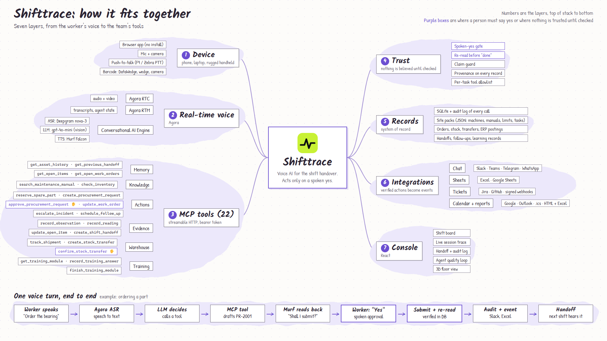

# SHIFTTRACE

**The maintenance system remembers the tickets. SHIFTTRACE remembers what actually happened, and what is still unknown.**

A voice-first, camera-aware maintenance assistant for PS31 (Voice AI at Work: Field Technician Copilot), Build with Agora Bengaluru 2026.

A technician talks to the machine's memory hands-free. The agent retrieves history and the previous shift's handoff, looks at the panel through the phone camera, records what is seen and said **with provenance**, checks stores, drafts a procurement request that only goes out after the technician's own spoken "yes", updates the work order, and writes a handoff for the next shift. The next technician asks "what happened, what did we try, what's still open?" and gets an answer built only from stored records.

## How it works




```
Browser (technician console)                     Agora cloud                        SHIFTTRACE backend
  mic + camera ── RTC ──────────────────────▶  ConvoAI agent                     ┌─ MCP server :8001 (tunnelled, bearer auth)
  agent audio ◀─ RTC ───────────────────────   ASR  Deepgram nova-3 (managed)    │   22 tools: history, handoff, manual (BM25),
  transcripts/state ◀─ RTM ─────────────────   LLM  gpt-4o-mini (managed, vision)│   inventory, reserve, procurement draft/approve,
  transcripts, snapshots ─▶ console API :8000  TTS  Murf FALCON (BYOK)           │   work order, escalate, evidence, handoff
                                                tools ── MCP streamable_http ─────┘
                                                                                  └─ console API :8000 (local) + SSE + SQLite
```

See [docs/ARCHITECTURE.md](docs/ARCHITECTURE.md).

## Not one scenario: every frontline job in the track

The track lists field technicians, the factory floor, warehouse and logistics, productivity, and training and onboarding. Shifttrace runs live workflows for each of them on one engine:

| Track example | Live workflow | Actions through tools |
|---|---|---|
| Field technician copilot | Compressor C-204, *Troubleshoot a fault* | history, handoff, manual, stock, draft order then spoken yes, work order |
| Factory floor assistant | Conveyor CV-310, *Preventive maintenance* | PM checklist step by step, readings against limits, reserve consumables |
| Warehouse and logistics | Pick zone DC2-ZB, *Warehouse operations* | stock by location, shipment tracking, stock transfer after a spoken yes, ERP posting |
| AI training and onboarding | Any machine or zone, *Training and onboarding* | spoken quiz, answers marked in code against the manual, learning record updated |
| Employee productivity | Every task | follow-ups scheduled with a due date and owner, handoff written from records, next-shift briefing by voice |

Every one runs the track's demo flow: initiate by voice (Agora Conversational AI and Murf Falcon), understand (records, manual or SOP, camera), execute (MCP tools on real records), confirm (spoken yes for critical actions, every write re-read, failures said plainly), follow up (handoff, follow-ups, ERP posting, audit log).

## Connected systems and the improvement loop

- **Real integrations.** Every verified action (order submitted, stock transfer posted to the ERP, escalation, follow-up, handoff, learning record, out-of-limit reading) becomes a business event. It is delivered to whatever the site connects in `backend/.env`:
  - Slack and Microsoft Teams messages
  - Jira or GitHub issues for escalations and follow-ups
  - HMAC-signed JSON webhooks for ERP, CMMS or automation tools (Zapier, Make, n8n)
  - an `.ics` calendar feed of follow-ups

  Each delivery is logged and retried, and you can see them in **Connected systems**. A built-in local test receiver verifies signatures, so the pipeline can be shown without any external account.
- **The improvement loop.** `scripts/scenarios.py` drives the real agent with recorded speech and camera scenes, and every step is scored. Each failure goes into `experiments/FAILURES.md` (41 so far) with its root cause and fix, and is pinned by a test. **Agent quality** shows the runs, the pass rate per run, the fixes and the media dataset (Creative Commons photos, derived videos, rendered panels and speech, each with licence and source in `experiments/media/MEDIA_SOURCES.json`). Grow the dataset with `scripts/fetch_dataset.py`.

## Cost and devices

- **Not live all the time.** The agent runs only during a session and pauses itself after silence, and the camera can be on demand. Each session shows its measured cost, and System projects the cost per worker per shift (about $1.40 for 40 active minutes at list prices, versus about $14.60 to stream a full shift).
- **Rugged devices.** It runs in the browser on Android rugged handhelds and wearables. Barcode and QR scans work through DataWedge keystroke output or any keyboard-wedge scanner, and there is push-to-talk on Space or F9.

See [docs/COST_AND_DEVICES.md](docs/COST_AND_DEVICES.md).

## Packs and tasks

Machines and their history come from **data packs** (`demo_data/packs/*`). What the session is for comes from **tasks** (`demo_data/tasks.json`). Four packs ship: a compressor fault (C-204), a packaging-line conveyor with a PM due (CV-310), an office-tower air handler on its inspection round (AHU-3) and a distribution-centre pick zone with a delayed inbound and a pick face below minimum (DC2-ZB). Six tasks ship: *Troubleshoot a fault*, *Preventive maintenance*, *Inspection round*, *Warehouse operations*, *Training and onboarding* and *Shift briefing (no changes)*. The technician picks both when starting a session. The task changes the agent's goal, procedure, greeting and tool allowlist, and the safety rules come from the machine. To add your own, see [docs/CONFIGURING_USE_CASES.md](docs/CONFIGURING_USE_CASES.md).

## Run it

Prerequisites: Python via `uv`, Node 20+, `cloudflared` (`winget install Cloudflare.cloudflared`), and three secrets in `backend/.env`: `AGORA_APP_ID`, `AGORA_APP_CERTIFICATE`, `MURF_API_KEY` (template: `backend/.env.example`).

```powershell
.\start.ps1 -Reset            # builds the console, seeds all packs, starts API + MCP + tunnel
# other terminal
cd backend; uv run python -m app.preflight   # verifies Agora creds, Murf key + voice, tunnel (no billable session)
```

Open http://localhost:8000 for the product page (**Try the live demo** starts a voice session with a test feed, so no machine is needed); the console is at `/board`. Show http://localhost:8000/panel/<asset> (e.g. `/panel/C-204`, `/panel/CV-310`, `/panel/AHU-3`) on a second screen or phone as the "machine".
Details: [docs/SETUP.md](docs/SETUP.md). Demo script: [docs/DEMO_RUNBOOK.md](docs/DEMO_RUNBOOK.md).

The console is built around one trace. The Shift board shows what each machine has left open. A machine's page shows its log by shift and starts a session without a form. A session is one ordered log of speech, lookups, evidence and verified changes, with the handoff filling in beside it. **Finish and hand over** files the handoff, and the next technician starts their briefing from it. Stores and orders, the Audit log and System are secondary pages. See [docs/UI_DESIGN.md](docs/UI_DESIGN.md).

## What is real and what is simulated

| Real | Simulated (synthetic data) |
|---|---|
| Agora ConvoAI agent, RTC media, RTM transcripts | Machines C-204, P-117, CV-310, AHU-3, their history and manuals (all fictional) |
| Murf Falcon TTS through Agora | Stores inventory and suppliers |
| Agora-managed LLM reading camera frames | Procurement "supplier" (persisted in SQLite, nothing leaves the machine) |
| MCP tool calls from Agora cloud to our server | Control panel (a web page the camera looks at) |
| SQLite state changes, verification re-reads, audit log | |

Current verification status: [PROJECT_STATUS.md](PROJECT_STATUS.md).

## Tests

```powershell
cd backend
uv run python -m pytest -q          # 53 tests: workflow, agent config, approval gate, failures, MCP over HTTP, guard, capture, packs/tasks, reading limits
uv run python scripts/ui_smoke.py   # headless Edge: every page + console-driven workflow, screenshots to results/
```

## Deploy (Render)
The repo includes a `Dockerfile` and a `render.yaml` blueprint. In hosted mode one container serves the console and the MCP server on `$PORT`, so no tunnel is needed:
- `SHIFTTRACE_SINGLE_PORT=1` turns hosted mode on (set in the Dockerfile).
- The public URL comes from Render's `RENDER_EXTERNAL_URL` (or set `MCP_PUBLIC_URL`). Agora calls `<url>/mcp` with the bearer `MCP_TOKEN`.
- `CONSOLE_PASSWORD` is required: the console has no user accounts and can start paid Agora sessions. The browser asks for it (any user name).
- Set `AGORA_APP_ID`, `AGORA_APP_CERTIFICATE`, `AGORA_CUSTOMER_ID`, `AGORA_CUSTOMER_SECRET` and `MURF_API_KEY` in the Render dashboard.
- The free plan's disk is temporary: the synthetic demo data is re-seeded on each start, and the service sleeps when idle (the first request takes about a minute).

